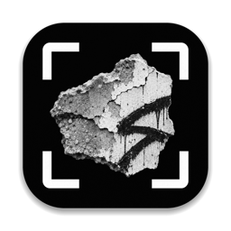
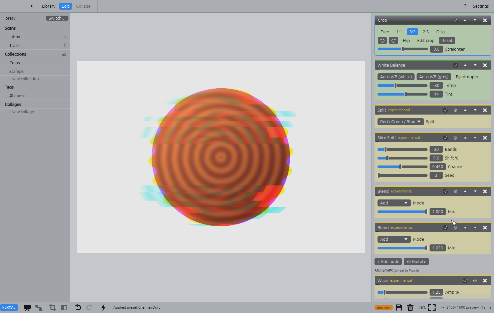
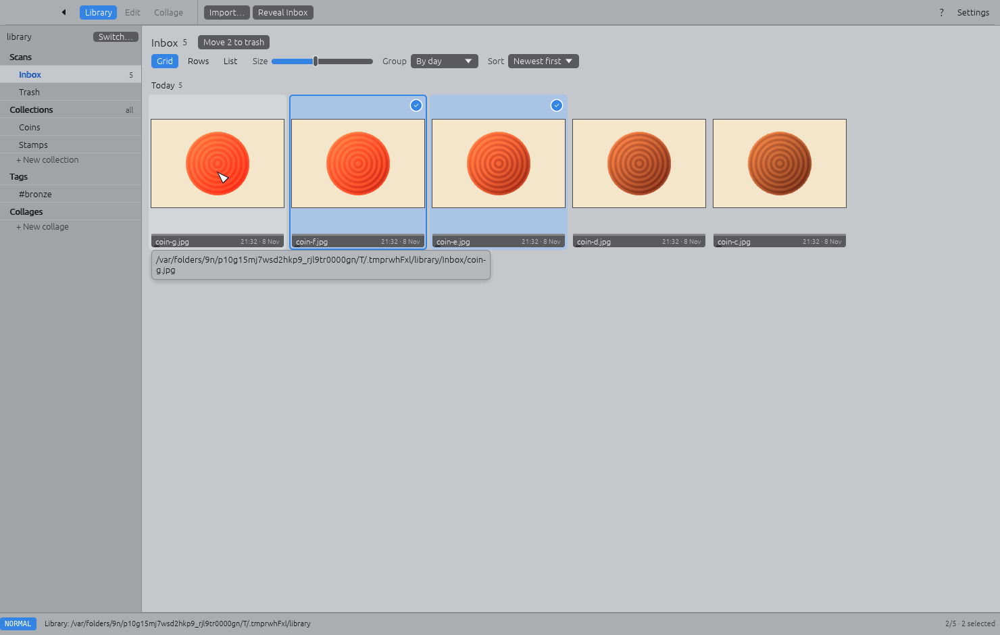
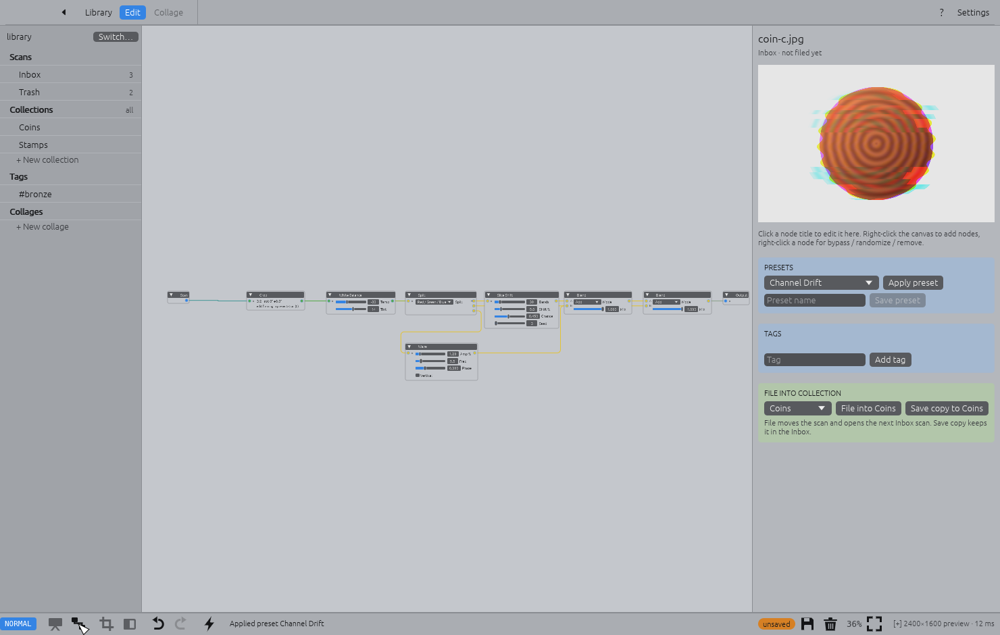
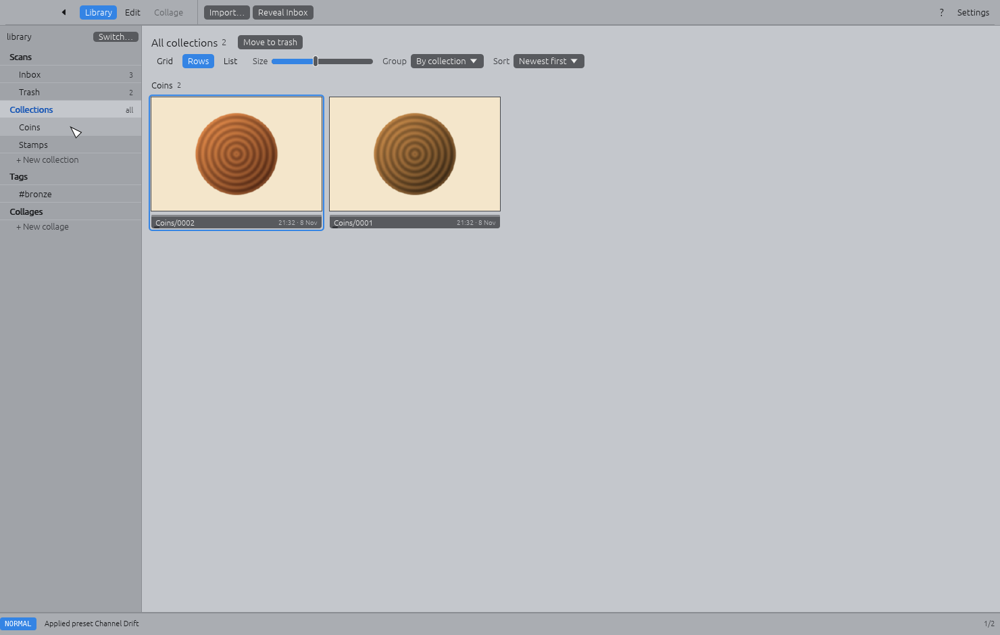
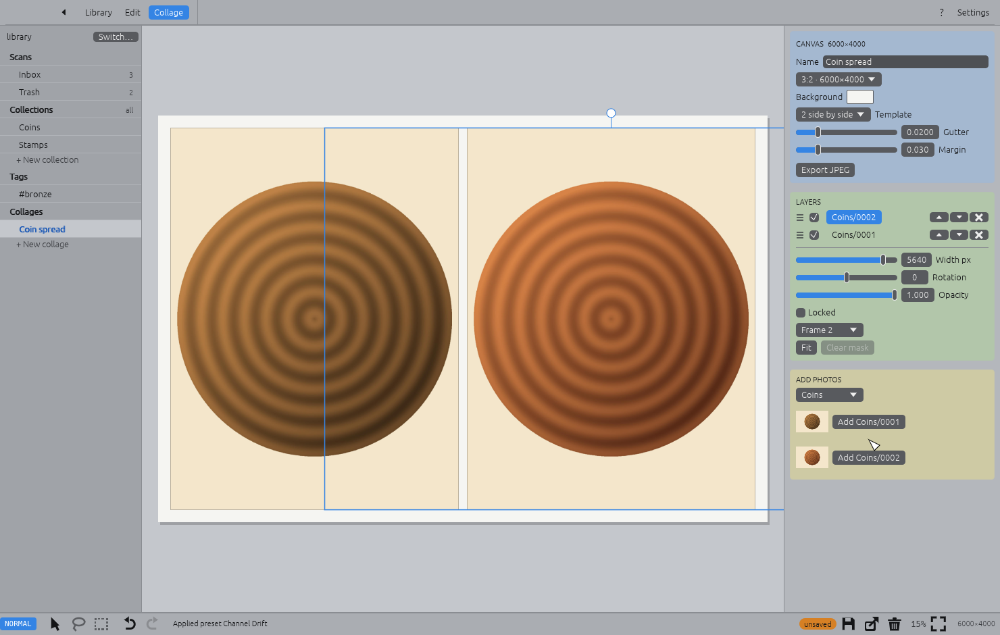
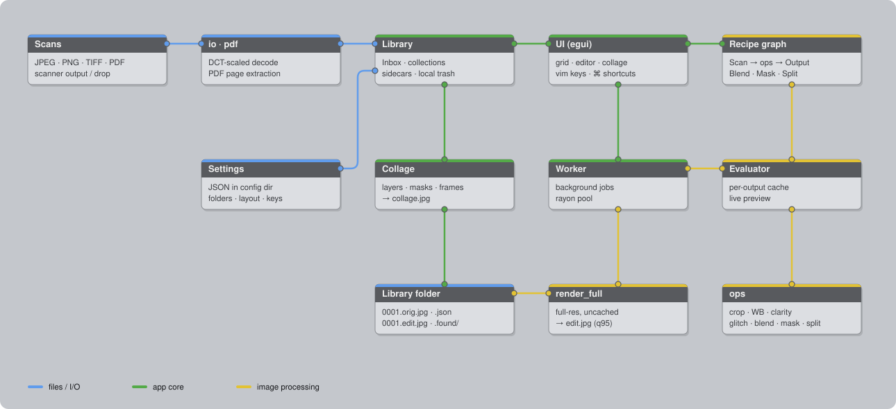

<p align="center"></p>

<h1 align="center">Found</h1>

A desktop app for scans of found objects — things picked up off the street, out of drawers,
from flea markets — put on the scanner bed. Crop, develop, glitch, tag, file into collections,
make collages. Rust + egui, everything stored as plain files.



## Typical workflow

1. **Scan** objects into the library's `Inbox/` folder (or drop files / PDFs on the window).
2. **Sort out** in the library: select with the mouse, `⌫` the rejects to Trash, double-click to open.
3. **Edit**: crop, white balance, exposure, clarity — or a preset / **Apply last** (`A`).
   Switch to **Patch** for branching glitch recipes. `]` goes to the next scan.
4. **File** into a collection (`m`, drag onto it, or *File into …*): the original is kept,
   the recipe saved, a full-res `edit.jpg` rendered.
5. **Collage** photos from your collections and export a JPEG.

| Library | Patch | Collections | Collage |
|---|---|---|---|
|  |  |  |  |

## Architecture



Scans are decoded (JPEG at reduced DCT scale for previews, PDFs unpacked) into the **Library** —
plain folders plus JSON sidecars. Each photo's edit is a **recipe graph** (egui-snarl); the
**Evaluator** runs it on a worker thread with a per-output cache for the live preview, and
`render_full` re-runs it uncached at full resolution to write `edit.jpg`. Originals are never
modified. `python3 scripts/diagram.py` redraws the diagram.

## Run & build

```sh
cargo run --release                 # startup picker (or: cargo run --release -- <library>)
cargo test                          # unit + headless UI tests
scripts/bundle-macos.sh --dmg       # → target/macos/Found.app + Found.dmg
```

GPL-3.0 · [credits](CREDITS.md)

Coming from the earlier name (Scanner)? Settings are copied over on first launch and each
library's hidden `.scanner` folder is renamed to `.found` when you open it.

# Reference

## Settings

Nothing folder-related is fixed in code. **Settings** (toolbar) holds:

- **Library folders** per library: Inbox, collages and presets — relative to the library or any
  absolute path (point Inbox straight at your scanner's output folder). *Apply folders* reopens
  the library; existing files are not moved.
- Open the last library automatically on startup (off by default → picker on every launch).
- JPEG export quality, preview size, thumbnail cache folder.
- Recent libraries (also editable on the picker). **Switch…** in the sidebar returns to the picker.

Stored as JSON in the OS config folder (`~/Library/Application Support/found/settings.json`);
set `FOUND_SETTINGS=/path/settings.json` to use another file.

## Editing

1. Copy scans (JPEG, PNG, TIFF or PDF) into `library/Inbox/` (or drop files / **Import…**).
   The library is sorted newest first and grouped by day (switchable; `:sort`, `:group`).
2. Double-click a scan (or select it and press Enter) → **Presentation** view: preview + the node chain as slider cards.
   - **Crop** 1:1 · 3:2 · 2:3 · Free · Orig, rotate 90°, flip, straighten. Drag the frame/corners.
   - **White Balance** temp/tint, **Auto WB (white)** (scanner lid), **Auto WB (grey)**, **Eyedropper**.
   - **Exposure**, **Brightness/Contrast**, **Clarity** (Fuji-style midtone local contrast), Saturation.
   - **+ Add node** › Basic / Experimental; ⏶ ⏷ reorder; checkbox bypasses; 🗙 removes.
3. **Patch** (`P`) shows the same recipe as a node graph — rewire, branch, blend.
4. **Presets**: built-in looks + glitch patches; *Save preset* stores the current sequence in
   `_presets/`. Applying a preset keeps the photo's crop and white balance.
5. Add tags, pick a collection, **File into …** → original moved to `Coins/0001.orig.jpg`,
   recipe in `0001.json`, full-res `0001.edit.jpg` rendered. The next Inbox scan opens.
6. Re-open any filed photo, tweak, **Save & render** (`⌘S`). Originals are never modified.
7. **Save copy to …** (⇧⌘S, `:saveas Coins`) adds a new numbered photo to a collection with
   the current edits — e.g. a glitch variant next to the clean one. The photo you're editing
   stays as it is (an Inbox scan stays in the Inbox).

### Apply last

**Apply last** (always in the editor toolbar; `A`, ⌘L, `:last`) applies the last preset you
applied or the edits of the last photo you saved — whichever came last — to the photo in
front of you. Like a preset it keeps this photo's crop and white balance unless the recipe
sets them. It's remembered across restarts. Handy for a batch: edit one, save, then `]` `A`
`⌘S` through the rest.

### Saving

Edits are not saved automatically. The toolbar shows **unsaved changes** and the status line
`[+]`; **Save** / `⌘S` / `:w` writes the recipe (and re-renders the edit of a filed photo;
in a collage it saves the document — **Export JPEG** / `:export` renders it). Leaving with
unsaved changes — another photo, another view, switching library, closing the window — asks
**Save / Don't save / Cancel** (Enter / N / Esc). `:q!` leaves without saving, `:e!` reverts
to the last saved version, `:wq` saves and goes back.

### Organising

- **All collections:** click the **Collections** heading in the sidebar (or `:collections`) to
  see every filed photo, grouped by collection.
- **Layout** (the strip under the title, or `:layout grid|rows|list`): **Grid** — equal tiles;
  **Rows** — equal-height rows with every photo at its own shape; **List** — one striped line
  per photo with date, collection, tags and edit status.
- **Size** slider (also `+` / `-` / `=`, ⌘+ / ⌘-, pinch or ⌘-scroll over the grid) sets the
  thumbnail size; it's remembered.
- **Group** by day, month, collection or not at all (`:group day|month|collection|none`).
  "All collections" keeps its own grouping. Day / month grouping needs date sorting.

- **Drag and drop:** drag photos from the grid onto a collection in the sidebar to move them
  there (the selection moves if you drag a selected photo). Inbox scans dropped on a
  collection are filed and rendered; filed photos move with their edit and recipe and get the
  next number in the new collection. Collages using a moved photo are updated. Drop on
  **Trash** to remove. `m` / `:file Name` does the same from the keyboard.
- **Rename a collection:** double-click it in the sidebar, right-click › **Rename…**, the
  **Rename…** button next to its title, or `:rename New name`. Collages and trashed photos
  that point into it are updated.

### Trash

Select the photos you don't want and press **Backspace** (or **Move to trash**, right-click ›
Move to trash, `dd` / `x`, `:trash`). In the editor ⌘Backspace trashes the current photo and
opens the next one (also the **Move to trash** button in the editor toolbar). Nothing leaves the library: the original, its rendered edit and its recipe
move to `.found/trash/` and appear under **Trash** in the sidebar (`gx`).

- `u` / ⌘Z in the library restores the last batch.
- In Trash: `r`, **Restore** or `:restore` puts photos back where they came from (an Inbox name
  that's taken gets a suffix; a reused collection id gets the next free id).
- Collages too: **Move to trash** in the collage toolbar, right-click a collage in the sidebar,
  or `:trash` / ⌘Backspace in the collage view (the `.json` and its exported `.jpg` go together).
- **Delete forever…** / **Empty trash…** (`:emptytrash`) remove files from disk, after a
  confirmation.

### Experimental nodes

RGB Split · Pixel Sort · Slice Shift · Block Glitch · Bit Crush · VHS · Dither · Pixelate ·
Grain · Mirror/Kaleido · Channel Swap · Invert · Wave · Blend (2 inputs) · Mask (3 inputs) ·
Split (3 outputs).

**Multiple inputs / outputs:** any output can feed as many inputs as you like (branches are
computed once). Each input takes one wire; nodes that combine images have several inputs:
**Blend** (A, B — mode + mix) and **Mask** (A where the mask is light, B where it's dark;
the mask input is optional — without it B's own brightness is used, so "glitch only the
highlights" is two wires). **Split** has three outputs — R / G / B or shadows / mids /
highlights — that add back up to the original with two **Blend › Add** nodes, so you can
treat each part differently. Each has 🎲 Randomize;
**🎲 Mutate** re-rolls every experimental node. All are seeded and resolution-independent, so the
full-res export matches the preview.

Built-in glitch presets: VHS Tape, Pixel Melt, Datamosh, RGB Ghost, Bit Crush, Scan Drift,
Kaleido, Thermal, Double Exposure (a branching patch), Channel Drift (Split → shift red, wave
blue → add back), Glitch Highlights (Mask: block glitch only on the bright parts).

### Bottom bar

One bar along the bottom holds everything: the vim mode, the current view's tools as flat
icons (black = on, grey = off, light = unavailable; hover for names and keys), the status /
command line, and on the right **unsaved**, Save, Move to trash, zoom % and Fit.

- Editor: Presentation / Patch, Crop, Before, Undo / Redo, Apply last.
- Collage: Move / Lasso cut / Rect mask, Undo / Redo — plus Export on the right.

### Collage

**New collage** in the sidebar. Canvas presets, background colour, split-frame templates with
gutter/margin, or Free. Layers panel (order, visibility, lock, frame, width/rotation/opacity).
Tools: **Move** (drag, corner = scale, top handle = rotate, scroll = zoom), **Lasso cut**,
**Rect mask** — masks are non-destructive. Reorder layers by dragging the ≡ grip in the
Layers panel, or right-click a layer (in the panel or on the canvas) for **Bring to front /
Bring forward / Send backward / Send to back**. Name a collage when creating it
(**+ New collage** in the sidebar, `:collage Name`); rename it with the Name field, a
double-click / right-click in the sidebar, or `:rename`. **Export JPEG** renders full-res from the sources.

### Keyboard

Press `?` (or ⌘/) for the full list for the current view. Vim-style modal keys are on by
default (`:set novim` or Settings to turn off); the status line shows the mode
(NORMAL / VISUAL / INSERT / COMMAND), pending keys and completions.

- **Everywhere:** `:` command line with Tab completion · `u` / `Ctrl-r` undo / redo · `q` back ·
  `gi gl ge gc gs gx` go to inbox / library / edit / collage / settings / trash · `gt` / `gT` next /
  previous collection · `gb` sidebar · `+ - = z1` zoom in / out / fit / 100% · counts (`5l`).
- **Library:** `h j k l`, `0 $ gg G`, `Ctrl-d/u` · `Enter`/`o` open · `v` visual select ·
  `Space` mark · `dd x Backspace` (visual `d`) move to trash · `r` restore (in Trash) ·
  `/ n N` search name or tag · `yy` yank recipe, `p` paste it onto the selection
  (each photo keeps its crop) · `t` → `:tag`, `m` → `:file` the selection.
- **Editor:** `j k` slider, `h l` adjust (`H L` coarse), `w b` node, `i` type a value, `x`/`X`
  reset slider/node, `.` repeat · `dd yy p P` delete / yank / paste node, `J K` move node,
  `o O` add node after / before (`:add pixel s<Tab>`), `Space` bypass · `c` crop, `aw ag e`
  auto WB white / grey, eyedropper · `R` randomize, `M` mutate · `] [` next / previous photo ·
  `Tab` patch · `\` before/after · `Y` yank recipe · `:w :q :wq`.
- **Crop:** `h j k l` (`H J K L` ×10) move, `> <` grow / shrink, `f s w t O` free / 1:1 / 3:2 /
  2:3 / original, `r R F` rotate / flip, `c`/`Enter`/`Esc` done.
- **Collage:** `Tab` layers, `h j k l` nudge, `> <` scale, `r R` rotate, `] [` order,
  `dd yy p` delete / yank / duplicate, `m M s` lasso / rect mask / move, `x` clear mask, `f` fit,
  `:w` export.
- **Commands:** `:file Coins`, `:tag a b`, `:untag a`, `:new Coins`, `:add Node`, `:preset Name`,
  `:savepreset Name`, `:crop 3:2`, `:sort date|name asc|desc`, `:group on|off`, `:collage`,
  `:saveas Coll`, `:rename Name`, `:q!`, `:e!`, `:export`, `:inbox`, `:trash`, `:restore`, `:emptytrash`, `:noh`, `:set vim|novim|compact`, `:12` (jump to item 12).
- **⌘ shortcuts (always on):** ⌘K command line, ⌘F search, ⌘Z/⇧⌘Z, ⌘S save, ⇧⌘S save copy, ⌘1 ⌘2 ⌘3 ⌘, views,
  ⌘\ sidebar, ⌘+ ⌘- ⌘0 ⌘9 zoom, ⌘[ ⌘] previous / next photo, ⌘↩ file, ⌘I import, ⌘N collage,
  ⌘A select all, ⌘Backspace move to trash.

**Mouse:** in the library a click selects, double-click opens, ⌘-click adds / removes, ⇧-click
selects a range, and dragging draws a selection rectangle (hold ⌘ / ⇧ to add to the
selection); right-click for Open / Reveal / Move to trash. Pinch or ⌘-scroll zooms the
preview / collage around the pointer; scroll, Space-drag or middle-drag pans; double-click
toggles fit / 100 %. ⌥-scroll scales the selected collage layer.

### PDFs

PDFs from a scanner dropped in the Inbox are unpacked automatically: each page's image is extracted
(JPEG streams byte-for-byte, Flate bitmaps as lossless PNG; multi-page → `name-p01.jpg`, …).
The PDF is kept in `.found/pdf-originals/` and each scan's sidecar records its source page.
JPEG 2000 / CCITT fax-encoded PDFs aren't supported yet (reported in the status line).

## Library layout (defaults)

```
library/
  Inbox/                 scans to process (configurable, can be outside the library)
  .found/                in-progress recipes for Inbox scans, trash/, pdf-originals/
  Coins/0001.orig.jpg    original
  Coins/0001.edit.jpg    rendered edit (JPEG q95, full res)
  Coins/0001.json        recipe graph + tags
  _collages/             collage-0001.json + .jpg
  _presets/              your presets
```

## macOS app

```sh
scripts/bundle-macos.sh                 # → target/macos/Found.app (this Mac's architecture)
scripts/bundle-macos.sh --dmg           # … plus target/macos/Found.dmg
scripts/bundle-macos.sh --universal --dmg --notarize   # signed + notarized release build
```

Signing uses the first **Developer ID Application** certificate in your keychain (override
with `SIGN_IDENTITY`), with the hardened runtime; without one the app is ad-hoc signed and only
runs on this Mac. `BUNDLE_ID` overrides the identifier (`io.github.shmuga.found`).

### Releases

One-time setup: create a *Developer ID Application* certificate (Xcode › Settings › Accounts ›
Manage Certificates › +) and store notarization credentials with an app-specific password
from appleid.apple.com:

```sh
xcrun notarytool store-credentials found-notary --apple-id you@example.com --team-id TEAMID
```

Then, per release:

```sh
scripts/bundle-macos.sh --universal --dmg --notarize
gh release create v0.1.0 target/macos/Found.dmg --title "Found 0.1.0" --generate-notes
```

### Icon

The icon is the found-concrete-fragment artwork in `assets/icon-source.jpg`, fitted into the
macOS icon shape as `assets/icon.png` (used by the window, the Dock and `Found.app`). To change
it: `scripts/set-icon.sh path/to/square-picture.png` (or `a|b|c` for the generated designs in
`examples/icon.rs`), then `scripts/bundle-macos.sh`.

## Licence

[GPL-3.0](LICENSE). Credits and font licences: [CREDITS.md](CREDITS.md).

## Tests

```sh
cargo test                                  # unit + headless UI e2e (egui_kittest)
cargo test --test screens -- --ignored      # renders screenshots to target/screens/
cargo run --release --example bench         # timings on a 50MP scan
```

Clarity follows the guided-filter approach from
[photocraft](https://github.com/storytold/photocraft) (MIT/Apache-2.0).
